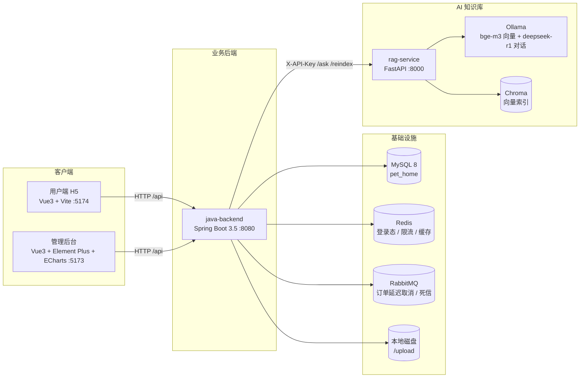

# 宠享到家（pet-home）

> 宠物上门服务平台：用户端 H5 + 管理后台 + Spring Boot 后端 + 本地 RAG 知识库问答服务。

宠享到家是一个可直接跑起来的全栈示例项目：用户在 H5 端浏览服务、加购、下单、支付、管理宠物档案与地址；
管理员在后台上架服务、排班、处理订单、维护知识库文档；AI 助手基于本地知识库回答宠物健康科普问题，
答案附带可溯源的参考资料，并对越界提问做确定性拦截。

## 目录

- [架构](#架构)
- [技术栈](#技术栈)
- [功能清单](#功能清单)
- [环境准备](#环境准备)
- [快速开始](#快速开始)
- [环境变量说明](#环境变量说明)
- [接口调用示例](#接口调用示例)
- [评测结果对比](#评测结果对比)
- [测试](#测试)
- [目录结构](#目录结构)
- [开发路线](#开发路线)
- [常见问题](#常见问题)
- [许可证](#许可证)

## 架构



请求链路要点：

1. H5 / 管理后台通过 Vite 代理把 `/api` 转发到 `java-backend`（开发期免跨域配置）。
2. 登录态使用 JWT + Redis 白名单，`/api/user/**` 与 `/api/admin/**` 分别校验 C 端与 B 端身份。
3. 下单写入订单表后投递 RabbitMQ 延迟消息，超时未支付自动取消；消费失败进入死信队列。
4. AI 问答由后端携带 `enabledDocIds`（当前启用文档范围）调用 `rag-service`，检索 + 生成均在本地完成。

## 技术栈

| 模块 | 技术选型 |
| --- | --- |
| 后端 | Java 17、Spring Boot 3.5.7、MyBatis-Plus 3.5.9、Flyway、JWT（jjwt 0.12.6）、Spring AMQP、Actuator |
| 存储 | MySQL 8、Redis、RabbitMQ（延迟队列 + 死信） |
| 用户端 | Vue 3.5、Vite 6、Element Plus、vue-router、axios |
| 管理端 | Vue 3.5、Vite 6、Element Plus、ECharts、Pinia |
| AI | Python 3.11~3.13、FastAPI、LangChain 1.x、Chroma 1.5、Ollama（bge-m3 / deepseek-r1:1.5b） |
| 测试 | JUnit 5 + AssertJ（后端 396 个用例）、Python `unittest` 冒烟测试 |

## 功能清单

**用户端（H5）**

- 手机号 + 密码注册 / 登录，登录态过期自动重登
- 服务分类、服务项目浏览与详情
- 购物车加购 / 改数量 / 删除 / 清空
- 下单、模拟支付、订单列表与详情、取消订单
- 宠物档案管理（品种、年龄、体重等）
- 地址簿管理（新增 / 修改 / 删除 / 切换默认地址）
- 可预约美容师与排班查询
- AI 宠物知识库问答（流式呈现答案与参考来源）

**管理端（Admin）**

- 管理员登录、鉴权拦截
- 服务分类与服务项目管理
- 美容师档案与排班管理
- 订单查询、状态流转
- 数据统计看板（营业额、订单量、服务热度）
- 知识库文档管理（增删改查、启用/停用、一键重建向量索引）
- 图片上传（魔数校验 + 类型/大小白名单）

**RAG 知识库服务**

- 文档切分、分批入库到 Chroma（可全量重建，重建互斥）
- 按 `enabledDocIds` 过滤后检索 top_k 片段，支持相关性阈值拦截
- 多轮对话上下文（最近 N 轮）、宠物信息注入
- 答案固定拼接免责声明，返回可溯源参考来源
- 引擎不可用（Ollama 未启动 / 模型未 pull）统一返回 503，不泄露内部堆栈

## 环境准备

| 依赖 | 版本要求 | 说明 |
| --- | --- | --- |
| JDK | 17+ | 后端编译运行 |
| Maven | 3.9+ | 后端构建 |
| Node.js | 18+ | 两个前端工程 |
| Python | 3.11 ~ 3.13 | RAG 服务 |
| MySQL | 8.x | 库名 `pet_home`，Flyway 自动建表 |
| Redis | 6+ | 登录态、限流 |
| RabbitMQ | 3.9+ | 订单延迟取消 |
| Ollama | 最新 | 需 `ollama pull bge-m3` 与 `ollama pull deepseek-r1:1.5b` |

> AI 功能是可选能力：不启动 `rag-service` 时其余业务功能不受影响，仅知识库问答接口不可用。

## 快速开始

### 1. 准备数据库与中间件

```sql
CREATE DATABASE pet_home DEFAULT CHARACTER SET utf8mb4 COLLATE utf8mb4_general_ci;
```

启动 Redis、RabbitMQ（本地默认端口 6379 / 5672）。表结构与演示数据由 Flyway 在应用启动时自动执行
（`db/migration` 为正式脚本，`db/dev` 仅在 `dev` profile 下加载）。

### 2. 启动 RAG 服务

```bash
cd pet-home-service/rag-service
cp .env.example .env          # Windows: copy .env.example .env
pip install -r requirements.txt
ollama pull bge-m3
ollama pull deepseek-r1:1.5b
python main.py                # 默认 http://localhost:8000
```

### 3. 启动后端

```bash
cd pet-home-service/java-backend
mvn spring-boot:run           # 默认 http://localhost:8080，dev profile 自动启用
```

健康检查：`curl http://localhost:8080/actuator/health`，返回 `{"status":"UP"}` 即启动成功。

### 4. 启动前端

```bash
# 用户端 H5
cd pet-home-service/pet-home-h5
npm install && npm run dev    # http://localhost:5174

# 管理后台
cd pet-home-service/pet-home-admin
npm install && npm run dev    # http://localhost:5173
```

### 5. 初始化知识库

首次启动后向量库为空，可通过管理后台「知识库文档 → 重建索引」触发一次全量重建，
或直接调用 `POST /api/knowledge/reindex`（见下方示例）。

## 环境变量说明

### rag-service（读取 `.env` 或系统环境变量）

| 变量 | 默认值 | 说明 |
| --- | --- | --- |
| `SERVER_PORT` | `8000` | 服务监听端口 |
| `LOG_LEVEL` | `INFO` | 日志级别 |
| `RAG_API_KEY` | 空（必须注入） | 与后端 `PETHOME_RAG_API_KEY` 一致，请求头 `X-API-Key` |
| `OLLAMA_BASE_URL` | `http://localhost:11434` | Ollama 地址 |
| `LLM_MODEL` | `deepseek-r1:1.5b` | 对话模型 |
| `LLM_TEMPERATURE` | `0.1` | 生成温度 |
| `OLLAMA_EMBEDDING_MODEL` | `bge-m3` | 向量模型 |
| `EMBEDDING_PROVIDER` | `ollama` | `ollama` / `huggingface` |
| `CHROMA_PERSIST_DIR` | `./chroma_db` | 索引持久化目录（相对路径） |
| `RETRIEVE_TOP_K` | `2` | 检索片段数 |
| `RETRIEVE_SCORE_THRESHOLD` | `0.5` | 相关性阈值，`0` 表示关闭 |
| `CHUNK_SIZE` / `CHUNK_OVERLAP` | `500` / `50` | 文本切分参数 |
| `HISTORY_MAX_ROUNDS` | `3` | 携带的历史轮数 |

完整清单见 `pet-home-service/rag-service/.env.example`。

### java-backend（系统环境变量）

| 变量 | 说明 |
| --- | --- |
| `SPRING_PROFILES_ACTIVE` | `dev`（默认）/ `prod` |
| `PETHOME_MYSQL_USERNAME` / `PETHOME_MYSQL_PASSWORD` | 数据库账号（dev 有默认值） |
| `PETHOME_REDIS_PASSWORD` | Redis 密码 |
| `PETHOME_RABBITMQ_USERNAME` / `PETHOME_RABBITMQ_PASSWORD` | MQ 账号 |
| `PETHOME_JWT_SECRET` | JWT 签名密钥，生产必填且 ≥ 32 字节 |
| `PETHOME_RAG_BASE_URL` / `PETHOME_RAG_API_KEY` | RAG 服务地址与鉴权 Key |
| `PETHOME_PAYMENT_CHANNEL` / `PETHOME_PAYMENT_ALLOW_MOCK` | 支付渠道与是否允许模拟支付 |
| `PETHOME_PAYMENT_CALLBACK_SECRET` | 支付回调验签密钥 |
| `PETHOME_UPLOAD_BASE_DIR` | 上传文件目录（默认 `./upload`） |
| `PETHOME_CORS_ALLOWED_ORIGINS` | 允许跨域来源，逗号分隔 |

完整清单见 `pet-home-service/java-backend/.env.example`。

> 仓库不包含任何真实密钥。`.env`、`*.log`、`chroma_db/`、`upload/`、`node_modules/`、`target/` 等均已在 `.gitignore` 中排除。

## 接口调用示例

### 知识库问答

```bash
curl -X POST http://localhost:8000/api/knowledge/ask \
  -H "Content-Type: application/json" \
  -H "X-API-Key: <RAG_API_KEY>" \
  -d '{
    "question": "猫咪多久洗一次澡比较合适？",
    "enabledDocIds": [343, 344, 345],
    "conversationHistory": [],
    "petInfo": {"breed": "英短", "age": 2, "weight": 4.5}
  }'
```

响应：

```json
{
  "answer": "……（正文）\n\n以上内容仅供科普参考，若宠物出现不适或症状严重，请及时前往宠物医院就医。",
  "references": [
    {"docId": 343, "title": "猫咪洗澡频率指南", "content": "……命中的片段……"}
  ]
}
```

### 重建向量索引

```bash
curl -X POST http://localhost:8000/api/knowledge/reindex \
  -H "Content-Type: application/json" \
  -H "X-API-Key: <RAG_API_KEY>" \
  -d '{"documents": [{"id": 343, "title": "猫咪洗澡频率指南", "category": "猫咪", "content": "……"}]}'
```

### 用户登录与地址列表

```bash
# 1) 注册（手机号 + 密码）
curl -X POST http://localhost:8080/api/user/register \
  -H "Content-Type: application/json" \
  -d '{"phone": "13900001111", "password": "abc123456"}'

# 2) 登录拿 token
curl -X POST http://localhost:8080/api/user/login \
  -H "Content-Type: application/json" \
  -d '{"phone": "13900001111", "password": "abc123456"}'

# 3) 携带 token 查询地址簿
curl http://localhost:8080/api/user/address/list \
  -H "Authorization: Bearer <token>"
```

## 评测结果对比

以下为本地单机 CPU 环境（Ollama + bge-m3 + deepseek-r1:1.5b）的实测记录，用于说明参数取舍，
非跨机器基准数据：

| 场景 | 检索配置 | 参考来源 | 响应耗时 | 行为差异 |
| --- | --- | --- | --- | --- |
| 相关提问（猫咪洗澡频率） | `top_k=2`，阈值 `0.5` | 2 条 | 约 16s | 命中知识片段，答案带来源与免责声明 |
| 相关提问（同问题，历史轮数 3） | `top_k=2`，阈值 `0.5`，`HISTORY_MAX_ROUNDS=3` | 2 条 | 约 16~23s | 追问可沿用上下文，首轮耗时略高于单轮 |
| 越界提问（与宠物无关） | `top_k=2`，阈值 `0.5` | 0 条 | < 1s | 相似度低于阈值直接走兜底话术，不调用模型 |
| 越界提问（阈值关闭 `0`） | `top_k=2`，阈值 `0` | 1~2 条 | 约 15s | 仍会召回弱相关片段，只能依赖 Prompt 约束拒答 |
| 知识库范围为空 | `enabledDocIds=[]` | 0 条 | < 1s | 跳过检索，直接返回兜底话术 |

相关性分数实测区间（bge-m3）：宠物相关问题首条片段 0.73~0.81，无关问题 0.30~0.38，
因此阈值取 `0.5` 时两侧均有余量；若业务问题常被误拦，可下调 `RETRIEVE_SCORE_THRESHOLD`。

## 测试

```bash
# 后端全量测试（需要本地 MySQL / Redis / RabbitMQ 可用）
cd pet-home-service/java-backend
mvn test

# RAG 服务冒烟测试（先启动服务；零第三方依赖）
cd pet-home-service/rag-service
python tests/test_smoke.py

# 需要覆盖真实模型链路时（耗时约 20s）
RAG_SMOKE_ASK=1 python tests/test_smoke.py
```

## 目录结构

```
pet-home/
├── README.md
├── LICENSE
├── .gitignore
└── pet-home-service/
    ├── java-backend/            # Spring Boot 后端
    │   ├── src/main/java/com/pethome/
    │   │   ├── controller/      # C 端 / B 端接口
    │   │   ├── service/         # 业务实现
    │   │   ├── mapper/          # MyBatis-Plus Mapper
    │   │   ├── entity/ dto/ vo/ # 数据模型
    │   │   ├── rag/             # RAG 客户端与降级
    │   │   ├── payment/         # 支付渠道适配
    │   │   ├── mq/              # 延迟取消队列
    │   │   └── common/ config/  # 统一结果、异常、鉴权、配置
    │   ├── src/main/resources/db/migration  # Flyway 正式迁移脚本
    │   ├── src/main/resources/db/dev        # 演示数据（仅 dev）
    │   └── src/test/java/       # 396 个集成 / 单元测试
    ├── pet-home-h5/             # 用户端 H5
    ├── pet-home-admin/          # 管理后台
    └── rag-service/             # RAG 知识库问答服务
        ├── main.py              # FastAPI 入口（日志 / 异常 / 探活）
        ├── app/
        │   ├── api/             # 问答与索引重建接口
        │   ├── rag/             # Prompt、问答链、向量库、异常翻译
        │   ├── config/          # settings（环境变量）+ constants（常量）
        │   └── utils/           # X-API-Key 鉴权
        ├── tests/test_smoke.py  # 冒烟测试
        └── requirements.txt
```

## 开发路线

- [x] 用户端 H5 全流程（登录 / 浏览 / 购物车 / 下单 / 支付 / 订单 / 宠物 / 地址）
- [x] 管理后台（服务、分类、美容师、排班、订单、统计、知识库、上传）
- [x] 订单超时自动取消（RabbitMQ 延迟队列 + 死信）
- [x] 本地 RAG 知识库问答（检索 + 生成 + 参考来源 + 阈值拦截）
- [x] 后端 396 个自动化测试覆盖核心链路
- [ ] 接入真实微信支付 / 支付宝并对账
- [ ] 对象存储（OSS）替换本地上传
- [ ] 向量库迁移到独立服务并支持增量索引
- [ ] 管理端权限细分（RBAC）与操作审计
- [ ] 部署编排（Docker Compose / K8s）与 CI

## 常见问题

**1. 问答接口返回 503**

`rag-service` 连不上 Ollama。确认 `ollama serve` 已启动，模型已 `ollama pull`，并检查 `OLLAMA_BASE_URL`。
服务端会把具体阶段写入日志，对外只返回可读提示。

**2. 问答总是返回「知识库中暂未收录相关内容」**

三种常见原因：索引未建立（先执行一次重建索引）、`enabledDocIds` 为空或与实际文档 id 不匹配、
`RETRIEVE_SCORE_THRESHOLD` 过高导致片段被过滤（可临时设为 `0` 验证）。

**3. 后端启动失败，提示安全自检未通过**

`prod` profile 要求 `PETHOME_JWT_SECRET`、数据库密码、RAG Key 等显式注入；本地开发请使用 `dev` profile。

**4. 端口被占用**

后端 `SERVER_PORT`、RAG `SERVER_PORT`、前端 `vite.config.js` 中的 `server.port` 均可调整。

**5. 上传图片后访问 404**

确认后端 `PETHOME_UPLOAD_BASE_DIR` 指向的目录可写，且静态资源映射 `/upload/**` 未被反向代理拦截。

**6. 首次问答特别慢**

向量模型与对话模型均为懒加载，首次调用需要加载模型；CPU 环境单次生成约 15~25s 属正常范围。

**7. 所有请求都返回 401「非法的 API Key」**

`RAG_API_KEY` 没有配置（默认值为空）。请复制 `.env.example` 为 `.env` 并设置 `RAG_API_KEY`，
同时保证后端 `PETHOME_RAG_API_KEY` 与之一致。

## 许可证

本项目基于 [MIT License](./LICENSE) 开源。
