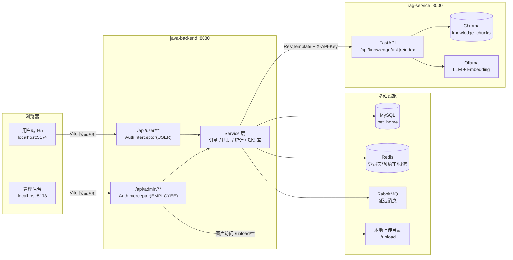
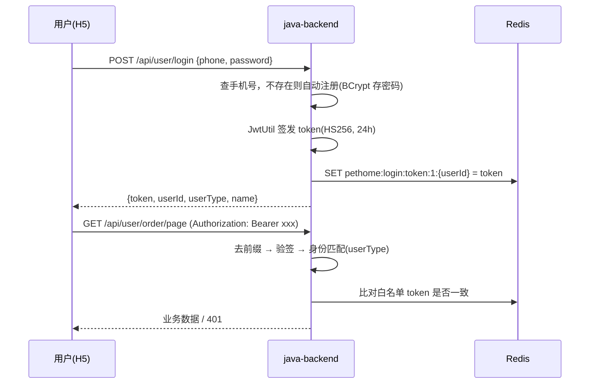
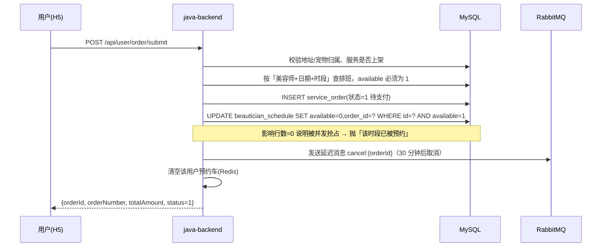
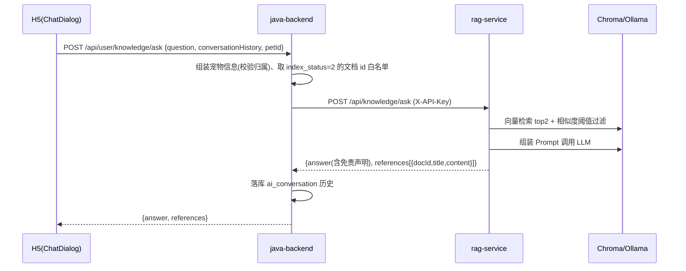

# 01 项目总览与整体架构

## 1. 技术原理：这类项目的架构关注点

一个「到店/上门服务」类业务系统的架构核心是回答四个问题：

1. **资源会不会被抢**：上门服务是「美容师 + 时段」的稀缺资源，同一时段不能被两个人占用 → 需要并发控制；
2. **状态机会不会错乱**：订单从下单到完成要走若干状态，任何异步环节（超时取消、到点提醒）都可能与用户操作打架 → 需要状态机 + 幂等；
3. **运营数据从哪来**：营业额、排行、复购率都来自订单与评价，需要统计口径统一；
4. **AI 能力怎么接入**：大模型不能直连前端（密钥、超时、降级、上下文组装都在服务端） → 需要独立的 AI 服务 + 后端做网关。

本项目的模块划分正是围绕这四点：**业务后端（含并发与状态机）+ 运营后台 + 用户端 + 独立 AI 服务**。

## 2. 本项目怎么用

### 2.1 模块职责与端口

| 模块 | 端口 | 说明 |
|---|---|---|
| `java-backend`（Spring Boot） | 8080 | 唯一对外业务 API；`/api/user/**` 与 `/api/admin/**` 两套鉴权 |
| `pet-home-admin`（Vite 开发服务） | 5173 | 开发期把 `/api`、`/upload` 代理到 8080 |
| `pet-home-h5`（Vite 开发服务） | 5174 | 同上 |
| `rag-service`（FastAPI） | 8000 | 只被 Java 后端调用（需 `X-API-Key`），不直接暴露给浏览器 |
| MySQL | 3306 | 库名 `pet_home` |
| Redis | 6379 | 登录态白名单、预约车、催单限流 |
| RabbitMQ | 5672 | 订单超时取消、到点提醒（依赖延迟消息插件） |
| Ollama | 11434 | 本地大模型 + 向量模型（`deepseek-r1:1.5b` + `bge-m3`） |

### 2.2 整体架构图



### 2.3 三条主数据流

**（1）登录与鉴权**



**（2）下单与排班占用（并发热点）**



**（3）AI 知识问答**



### 2.4 目录导览（关键位置）

```
宠享到家/
├─ docs/                              # ← 本手册
└─ pet-home-service/
   ├─ java-backend/
   │  └─ src/main/java/com/pethome/
   │     ├─ controller/               # C 端 UserXxxController / B 端 AdminXxxController
   │     ├─ service/ + service/impl/  # 业务实现（订单、排班、统计、知识库、地址、美容师…）
   │     ├─ mapper/                   # MyBatis-Plus BaseMapper（复杂 SQL 用注解写在这）
   │     ├─ entity/                   # 表实体（继承 BaseEntity）
   │     ├─ dto/  vo/                 # 入参 / 出参（用户端 VO 只暴露必要字段）
   │     ├─ common/                   # Result、枚举、常量、异常、UserContext
   │     ├─ config/                   # WebMvc、RabbitMQ、Jwt、上传、知识库客户端等
   │     ├─ interceptor/AuthInterceptor.java
   │     ├─ rag/                      # 调 RAG 服务的客户端（含 DTO）
   │     └─ mq/                       # 消息发送器与消费者
   ├─ pet-home-admin/                 # 管理后台（src/views 8 个页面）
   ├─ pet-home-h5/                    # 用户端 H5（src/views 9 个页面）
   └─ rag-service/
      ├─ main.py                      # FastAPI 入口（/health + /api/knowledge/*）
      └─ app/
         ├─ api/knowledge.py          # 问答与索引重建接口
         ├─ rag/chain.py              # 检索 → Prompt → 生成 → 摘除思考标签 → 拼免责声明
         ├─ rag/vector_store.py       # Chroma 封装
         ├─ rag/prompt.py             # Prompt 组装（含历史）
         └─ config/settings.py        # 全部可配置项（环境变量可覆盖）
```

## 3. 关键设计取舍一览（复习时优先看这张表）

| # | 问题 | 本项目方案 | 备选方案 | 为什么这么选 |
|---|---|---|---|---|
| 1 | 登录态怎么维护 | JWT 无状态 + **Redis 白名单** | 纯 JWT / 纯 Session | 纯 JWT 无法主动吊销（退出登录、改密码）；纯 Session 与多端/小程序不友好；「JWT + 白名单」兼顾无状态解析与可吊销 |
| 2 | 同一时段被两人抢 | **DB 层 CAS**：`UPDATE ... WHERE available=1` | 分布式锁（Redisson） | 单库场景下 CAS 足够且无额外依赖，影响行数=0 即抢占失败；分布式锁留作扩展 |
| 3 | 预约车存哪 | **Redis Hash + 7 天 TTL** | 数据库表 | 预约车是高频读写的临时数据，无需事务与长期留存；Hash 天然按 `serviceId` 去重累加 |
| 4 | 待支付超时取消 | **RabbitMQ 延迟消息**（`x-delayed-message`） | 定时任务扫表 | 定时任务有扫描延迟与全表压力；延迟消息到点即投递，代价是需要 broker 插件 |
| 5 | 到点提醒 | 确认订单时按「预约开始前 1 小时」再投一条延迟消息 | 前端轮询 | 与应用解耦，不依赖用户在线 |
| 6 | 状态判定 | **枚举 + 常量方法**（`OrderStatus.isUnfinished()`、`finishedCodes()`） | 散落的魔法数字 | 状态机规则集中，统计口径（含待评价）与删除校验复用同一处 |
| 7 | AI 问答放哪 | **独立 Python 服务**，Java 侧做网关 | Java 内调用模型 | 模型生态在 Python（LangChain/Chroma/Ollama）；Java 侧只负责鉴权、宠物上下文、文档白名单、历史落库与降级 |
| 8 | 用户端列表要不要带明细 | 带（`OrderVO.items`，**批量查询**） | 只给详情带 | 列表卡片要展示「服务名称 × 数量」；用一批查询装配，避免 N+1 |
| 9 | 前端登录凭证存哪 | localStorage（`user_token`） | httpOnly Cookie | 实现简单、跨端一致；代价是有 XSS 风险，见 [10 章](10-h5-frontend.md) 的安全提示 |
| 10 | 移动端适配 | viewport + **CSS 安全区域变量** + `dvh` | px→vw 插件 | 不引入额外依赖（`postcss-px-to-viewport` 需额外包），安全区域与键盘弹出用原生能力解决 |

## 4. 实践建议

- 读代码顺序建议：`Result` → `AuthInterceptor` → `OrderServiceImpl`（最复杂） → `RabbitMQConfig` → `rag/chain.py`；
- 数据一致性相关代码集中在 `OrderServiceImpl` 与 `AdminOrderServiceImpl`，改动前后务必跑 `mvn clean test`（见 [12 章](12-testing.md) 的增量编译坑）。

## 5. 本章踩坑

1. **不要用「一个服务搞定一切」的思路理解本项目**：AI 相关逻辑刻意不在 Java 内实现，Java 侧 `rag/` 包只是 HTTP 客户端（含重试、超时、降级），理解这一点后排查问答问题会快很多——先在 8000 端口验证，再看 Java 日志。
2. **端口即身份**：看到 5173/5174 是前端开发服务、8000 是 RAG、8080 才是业务 API；联调时「接口 404」先确认代理目标是否正确（见 [11 章](11-integration.md)）。
