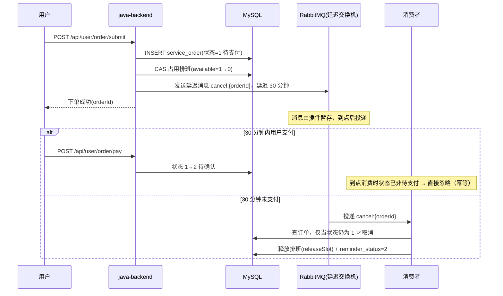

# 06 RabbitMQ 延迟消息

## 1. 技术原理

### 1.1 延迟消息要解决什么

典型场景：**下单 30 分钟未支付自动取消**、**预约前 1 小时提醒用户**。它们的共同点是「到某个未来时刻才需要执行的动作」。

三种主流实现：

| 方案 | 原理 | 优点 | 缺点 |
|---|---|---|---|
| 定时任务扫表 | 每分钟扫描超时订单 | 无额外依赖 | 精度受扫描周期限制、全表/索引压力大、多实例要抢锁 |
| TTL + 死信队列 | 消息过期进 DLX | 只用原生能力 | 队头阻塞（前面长 TTL 未到期会挡住后面短 TTL） |
| **延迟消息插件** | `x-delayed-message` 交换机，Broker 内部暂存、到点投递 | 精准、每条消息可任意延迟 | 需要安装 `rabbitmq_delayed_message_exchange` 插件 |

本项目选第三种，并保留「插件不可用时降级启动」的开关。

### 1.2 可靠性相关概念

- **Publisher Confirm**：Broker 确认「消息已到达交换机」，`setConfirmCallback` 拿到 ack/nack；
- **mandatory + Return**：当消息**无法路由到队列**时回退给生产者；
- **幂等消费**：MQ 只保证「至少一次」，重复投递是常态，消费端必须能安全重放。

## 2. 本项目怎么用

### 2.1 拓扑（`config/RabbitMQConfig.java`）

```
order.delay（x-delayed-message，内部按 direct 路由）
   ├──(order.cancel)→ order.cancel.queue     # 待支付超时取消
   └──(order.remind)→ order.remind.queue     # 预约到点提醒
order.direct（普通 direct）
   └──(order.reminder)→ order.reminder.queue # 催单即时通知
```

```java
// 延迟交换机（需插件）
@Bean
public CustomExchange orderDelayExchange() {
    Map<String, Object> arguments = new HashMap<>(2);
    arguments.put(MqConstant.DELAYED_ARG_NAME, MqConstant.DELAYED_ARG_VALUE);   // x-delayed-type=direct
    return new CustomExchange(MqConstant.ORDER_DELAY_EXCHANGE,
            MqConstant.DELAYED_EXCHANGE_TYPE, true, false, arguments);
}
```

延迟相关 Bean 用条件装配，插件不可用时关掉开关即可启动：

```java
@Configuration(proxyBeanMethods = false)
@ConditionalOnProperty(prefix = "pethome.mq", name = "delayed-enabled",
        havingValue = "true", matchIfMissing = true)
public static class DelayedExchangeConfiguration { ... }
```

```yaml
pethome:
  mq:
    delayed-enabled: true     # 无插件时置 false，服务仍可正常启动
  order:
    cancel-delay-millis: 1800000   # 30 分钟
```

### 2.2 超时取消的完整时序



### 2.3 消息发送

```java
// service/impl/OrderServiceImpl.submit() 第 9 步
mqMessageSender.sendOrderCancelDelayed(order.getId(), orderProperties.getCancelDelayMillis());
```

- 消息体是 JSON（`Jackson2JsonMessageConverter`），由 `correlationData` 关联；
- 订单表把消息标识也落库：`order.messageId = "cancel:{orderId}"`，确认订单后改为 `"remind:{orderId}"`（便于排查「这条订单的提醒消息到底发出去没有」）。

### 2.4 到点提醒的时间计算

提醒时间不是固定延迟，而是「预约开始时间往前推 1 小时」：

```java
// 预约日期 + 时段开始时间 → 减 1 小时 → 作为延迟时长（已不足 1 小时则立即投递）
LocalDateTime remindAt = LocalDateTime.of(order.getAppointmentDate(), TimeSlot.startTimeOf(order.getTimeSlot())).minusHours(1);
```

`TimeSlot.startTimeOf("10:00-12:00")` 返回 `10:00`，这个解析能力由枚举自己提供（见 `common/enums/TimeSlot.java`）。

### 2.5 幂等消费（关键）

消费端**先查订单 + 校验状态，再决定是否执行**：

- 超时取消消费者：仅当订单仍是「待支付」才取消（用户已支付/已取消则直接忽略）；
- 取消时同步释放排班（`releaseSlot`）并把 `reminder_status` 置为 2（已取消）。

这样即使消息被重复投递，第二次执行时状态已变，天然幂等。

## 3. 易错点与实际踩过的坑

1. **延迟交换机场景下 `mandatory` 必须关闭**（本项目在配置里专门写了注释）：
   `x-delayed-message` 交换机在**投递时点**才知道路由目标（消息先被插件暂存、到点再投递），如果开启 mandatory，Broker 会立刻返回 `basic.return(NO_ROUTE)`，造成「延迟消息被误判为路由失败」的假象。消息是否到达交换机由 **Publisher Confirm** 保障即可。

2. **延迟消息不是「定时任务替代品」的万能解**：它只保证「至少一次、大致准时」，不保证精确到秒；对时间精度要求极高的场景要另加兜底扫描。

3. **`RabbitAdmin` 要显式声明**：让拓扑在启动期就创建完成，避免「服务刚起来第一条业务消息先于队列声明」导致 NO_ROUTE。

4. **异步执行要放在事务提交之后**：与 MQ 类似的「提交后动作」，本项目统一用 `afterCommit(Runnable)` 包装：

   ```java
   private void afterCommit(Runnable action) {
       if (TransactionSynchronizationManager.isSynchronizationActive()) {
           TransactionSynchronizationManager.registerSynchronization(new TransactionSynchronization() {
               @Override public void afterCommit() { action.run(); }
           });
       } else { action.run(); }
   }
   ```
   **原因**：如果消息在事务提交前发出，消费端可能先于提交读到旧数据（甚至读不到），出现「消息处理了但业务数据没落库」。

5. **重复消费要能安全重放**：别把幂等寄希望于「MQ 只投一次」，一定用「业务状态判断」兜住（本项目靠订单状态 + 排班占用状态）。

6. **本地时间与延迟分钟数要一致**：延迟时长由 `LocalDateTime` 与 `LocalDate + LocalTime` 组合计算，注意时区统一（JVM 与数据库都按 `Asia/Shanghai`，`application.yml` 有显式配置）。
