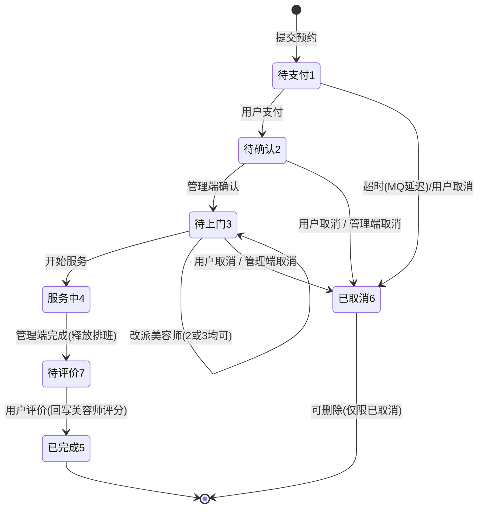

# 07 订单域：状态机与并发

> 这一章是全项目最核心、也最容易出 bug 的部分：**状态流转 + 排班并发 + 事务边界**。

## 1. 技术原理

### 1.1 用显式状态机管理订单

订单不能靠 `if (status != 5 && status != 6)` 这种散落判断维护，否则改需求时必然漏改。做法：

- 用**枚举**集中定义状态与描述；
- 把「哪些状态算未完成」「哪些算已完成（统计口径）」也收进枚举方法；
- 每个操作入口先做**状态前置校验**，非法流转直接拒绝。

### 1.2 并发抢资源：CAS 优于「先查后改」

「先查 available=1，再 UPDATE」在并发下必然超卖（两个线程都查到 1）。正确做法是把判断放进 SQL：

```sql
UPDATE beautician_schedule SET available = 0, order_id = ?
WHERE id = ? AND available = 1     -- 条件不满足则影响行数 0
```

**影响行数即结果**：1 = 抢占成功，0 = 被别人抢先。这利用的是数据库单条 UPDATE 的原子性，比分布式锁轻得多。

### 1.3 事务边界：只包住「必须原子」的部分

事务开得越大，锁持有越久、连接占用越久。原则：

- 纯 DB 写操作放事务；
- **慢操作（HTTP 调用、MQ 发送、文件 IO）坚决不放进事务**；
- 需要「提交后再做」的动作，用 `TransactionSynchronization.afterCommit`。

## 2. 本项目怎么用

### 2.1 状态定义（`common/enums/OrderStatus.java`）

```java
PENDING_PAY(1,"待支付") PENDING_CONFIRM(2,"待确认") PENDING_VISIT(3,"待上门")
IN_SERVICE(4,"服务中") COMPLETED(5,"已完成") CANCELED(6,"已取消") PENDING_COMMENT(7,"待评价")

isUnfinished(code)  → 1 ~ 4     // 关联数据删除校验用（有未完成订单不能删宠物/服务/美容师）
finishedCodes()     → [5, 7]    // 统计口径：服务已完成（含待评价）
```

选择「完成 → 待评价 → 已完成」而不是「完成即终态」的原因：**评价是独立动作**，把「已服务完但还没评价」这个中间态显式建出来，才能实现「去评价」入口与评分回写。

### 2.2 状态流转图



> 状态 4（服务中）**不允许用户取消**（服务已开始），只能由管理端完成；这也是前端按钮矩阵的依据（见 [10 章](10-h5-frontend.md)）。

### 2.3 下单：10 步流程（`OrderServiceImpl.submit`）

```java
// 1. 时段合法性（枚举校验）
if (!TimeSlot.isValid(timeSlot)) throw new BusinessException(SLOT_NOT_AVAILABLE, "非法时段：" + ...);
// 2. 归属与存在性校验：地址、宠物（必须属于当前用户）、美容师
checkAddress(request.getAddressId(), userId); checkPet(...); checkBeautician(...);
// 3. 服务项校验（上架）+ 按下单快照算总价（name/price 存入 order_detail，后续改价不影响历史单）
// 4. 排班校验：该「美容师+日期+时段」必须存在且 available=1，否则「该时段不可约」
// 5. INSERT service_order（状态=1 待支付，备注 trim 后落库）
// 6. CAS 占用排班：occupySlot，影响行数 0 → 抛「该时段已被预约」（异常 → 整个事务回滚，含第 5 步）
// 7. 回写 scheduleId 与 messageId（cancel:{orderId}）
// 8. 批量 INSERT order_detail
// 9. 发送延迟取消消息（30 分钟）
// 10. 清空该用户预约车（Redis）
```

**第 6 步的设计要点**：订单 INSERT 在 CAS 之前，靠**抛异常触发事务回滚**来撤销订单行——不需要手写补偿逻辑。

### 2.4 取消：一套逻辑复用三个入口

用户取消、管理端取消、MQ 超时取消最终都走同一个私有方法（`doCancel`）：校验状态 → 释放排班（`releaseSlot(scheduleId, orderId)`）→ 置 `reminder_status=2` → 落库。**入口不同但状态机与资源释放只有一份实现**，这是「三处入口一处规则」的典型好处。

### 2.5 事务与异步的配合

```java
// 事务提交后再发消息/清缓存，避免消费端读到未提交数据
afterCommit(() -> mqMessageSender.sendOrderCancelDelayed(orderId, delayMillis));
```

反例（本项目刻意避免）：`KnowledgeServiceImpl.ask()` **不加事务**，代码注释写明原因——RAG 调用是秒级慢操作，放进事务会长时间占用数据库连接；落库只是单条 insert，自动提交即可。

### 2.6 统计口径

数据统计（营业额、服务排行、美容师业绩、复购率）统一使用 `OrderStatus.finishedCodes()`（**5 已完成 + 7 待评价**），营业额按**支付时间**归自然日。**口径集中在一处**，避免「列表算一次、报表算一次」导致对不上。

## 3. 易错点与实际踩过的坑

1. **两种失败必须区分清楚**（前端提示文案不同）：
   - 「该时段不可约」= 排班压根不存在或已被管理端关闭（**用户可以从容换时段**）；
   - 「该时段已被预约」= 排班存在但刚被别人抢先占用（**并发冲突**）。
   两者对应不同的 `bizCode`（601/602），前端可以按码做不同引导。

2. **CAS 失败必须抛异常，不能「静默 return」**：否则订单已经 INSERT 但排班没占用，产生「幽灵订单」。本项目靠抛 `BusinessException` 让事务整体回滚。

3. **状态前置校验写在 Service 层，不要只写在 Controller**：Controller 只转发，把规则放 Service 才能被其它调用方（MQ 消费者、管理端服务）复用。

4. **`getCode()` 返回的是基本类型 `int`**：`OrderStatus.CANCELED.getCode().equals(...)` 会编译报错「无法取消引用int」。正确写法 `Integer.valueOf(OrderStatus.CANCELED.getCode()).equals(order.getStatus())`（顺带避免 `status` 为 null 时的 NPE）。

5. **关联数据删除要先查未完成订单**：删宠物/服务/美容师前都用 `OrderStatus.isUnfinished()` 统计未完成订单数，非 0 则拒绝并给出具体数量。

6. **改派美容师的语义**：允许在状态 2 或 3 改派，但**不调整排班占用**（本项目只在页面提示这一点）。如果需要「改派同时换排班」，要额外处理旧排班释放与新排班占用，属于未实现项（见 [14 章](14-todo-and-optimization.md)）。

7. **超时取消与手动取消的竞态**：用户点取消的同一时刻 MQ 消息也到点，两个流程都会走 `doCancel`。靠「状态校验 + 影响行数」保证只有一个生效（第二次进来时状态已是 6，直接被拒）。

8. **金额一律用 `BigDecimal`**（`price`、`totalAmount`、`amount` 全员 BigDecimal），不要用 `double` 计算金额；前端展示用 `Number(x).toFixed(2)`。
